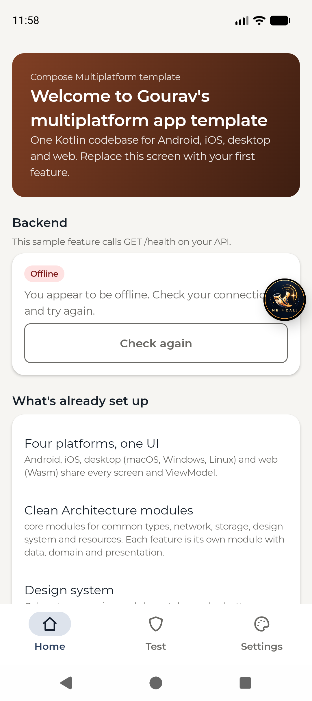
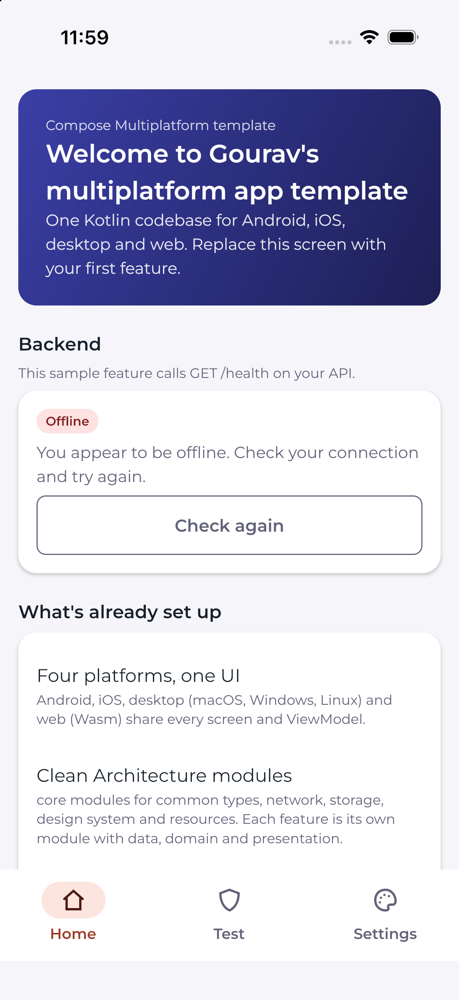
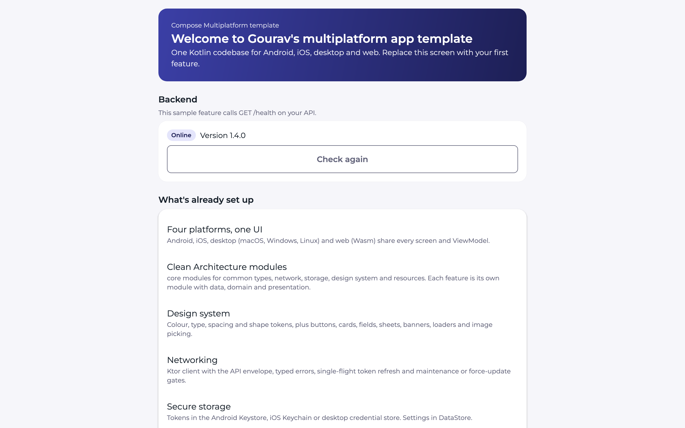
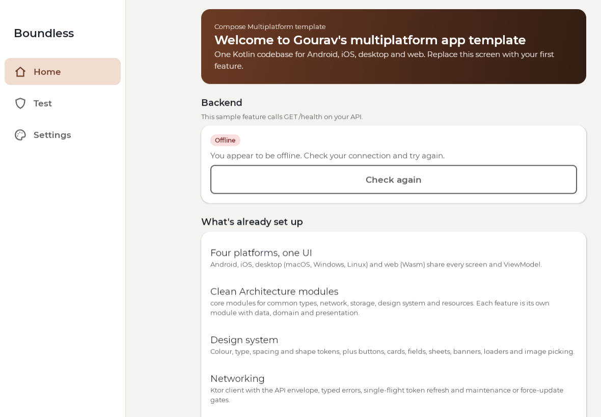

# Gourav's Compose Multiplatform template

One Kotlin codebase for **Android, iOS, desktop (macOS, Windows, Linux) and web (Wasm)**, with
the structure, rules and tooling already decided. Start every new app from here.

Package: `com.boundless.template` · Kotlin 2.4 · Compose Multiplatform 1.13 · AGP 9 · Gradle 9

## Screenshots

The shared Home screen on mobile and wide layouts. Click an image for full resolution.

<table>
  <tr>
    <th align="center">Android · Pixel 9a emulator</th>
    <th align="center">iOS · iPhone 17 Pro simulator</th>
  </tr>
  <tr>
    <td align="center"><a href="docs/screenshots/android.png"></a></td>
    <td align="center"><a href="docs/screenshots/ios.png"></a></td>
  </tr>
  <tr>
    <th align="center">Desktop · Compose-rendered preview</th>
    <th align="center">Web · running Wasm app</th>
  </tr>
  <tr>
    <td align="center"><a href="docs/screenshots/desktop.png"></a></td>
    <td align="center"><a href="docs/screenshots/web.png"></a></td>
  </tr>
</table>

Android, iOS and web are direct captures of the running apps. The desktop image is the
`RenderScreens` Home preview with sample data, not a native window screenshot: macOS screen
capture permission was unavailable. It omits the app shell and window chrome. No Windows or
Linux screenshots were captured. The other images show the expected offline state with no
backend running; Android debug also shows the Heimdall inspector. Themes are saved per device.

<details>
<summary>Refreshing these images</summary>

- Android: build/install the current debug app, open Home, then use
  `adb exec-out screencap -p > docs/screenshots/android.png`.
- iOS: build/install the current simulator app, open Home, then use
  `xcrun simctl io booted screenshot docs/screenshots/ios.png`.
- Desktop preview: run `./gradlew :desktopApp:test --tests '*RenderScreens' -Drender=true`
  and copy `desktopApp/build/render/home-desktop.png` to `docs/screenshots/desktop.png`.
  Replace it with a real window capture when screen-recording permission is available.
- Web: run `./gradlew :webApp:wasmJsBrowserDevelopmentRun`, open Home and capture the `#app`
  element at a desktop browser width to `docs/screenshots/web.png`.

</details>

## What's already set up

| Area | What you get | Where |
|---|---|---|
| Platforms | Android, iOS, desktop, web share every screen and ViewModel | `androidApp/`, `iosApp/`, `desktopApp/`, `webApp/` |
| Architecture | Clean Architecture + MVVM, one Gradle module per feature | [docs/architecture.md](docs/architecture.md) |
| Build | Convention plugins so a module's build file is ~10 lines | `build-logic/` (`boundless.kmp.library`, `boundless.kmp.compose`) |
| Design system | Tokens (colour, type, spacing, shape) and components: buttons, cards, rows, fields, chips, sheets, banners, loaders, date/time pickers, image picker and cropper | `core/designsystem/` |
| Strings and fonts | Compose Resources, one `strings_<area>.xml` per feature | `core/resources/` |
| Networking | Ktor, API envelope, typed `DomainError`, single-flight token refresh, maintenance/force-update gate | `core/network/` |
| Storage | Tokens in Keystore / Keychain / desktop credential store; settings in DataStore | `core/datastore/` |
| Database | Room 3 on all four platforms; bundled SQLite on native/JVM, SQLite Wasm + OPFS on web | `core/database/` |
| Developer tools | Debug-only Test section with Database, Design system and Core checks; Settings owns theme selection | `feature/devtools/`, `shared/.../app/SettingsScreen.kt` |
| DI and navigation | Koin, type-safe Navigation Compose | `shared/.../app/di/`, `shared/.../app/navigation/` |
| Crash reports and analytics | Firebase Crashlytics + Analytics on Android and iOS, off until you add config | `androidApp/build.gradle.kts`, `iosApp/` |
| Debug inspector | Heimdall overlay in Android debug builds | `androidApp/.../MainActivity.kt` |
| Sample feature | `feature:home`: welcome screen + backend health check, with tests | `feature/home/` |
| Coverage | Kover across all modules | root `build.gradle.kts` |

What is **not** here yet is listed in [docs/TODO.md](docs/TODO.md).

## Run it

| Platform | Command / steps |
|---|---|
| Android | Open the folder in Android Studio and run `androidApp`, or `./gradlew :androidApp:installDebug` |
| iOS | Set `TEAM_ID` in `iosApp/Configuration/Config.xcconfig`, open `iosApp/iosApp.xcodeproj` in Xcode, run. Xcode builds the Kotlin framework through `:shared:embedAndSignAppleFrameworkForXcode`. |
| Desktop | `./gradlew :desktopApp:run` |
| Web | `./gradlew :webApp:wasmJsBrowserDevelopmentRun`, then open http://localhost:8081 |

Behind a TLS-inspecting proxy (e.g. Zscaler) Gradle can't download Node.js for the web build. Add
`-PuseSystemNode=true` to use the installed `node` instead (root `build.gradle.kts`).
On Node versions that support the system CA store, use `NODE_OPTIONS=--use-system-ca` when
the same proxy blocks npm package installation. For an explicit project path from another folder:
`/path/to/cmp-template/gradlew -p /path/to/cmp-template :webApp:wasmJsBrowserDevelopmentRun -PuseSystemNode=true`.

The web database requires COOP/COEP headers for persistent OPFS storage. The dev server sets
them; production hosting must do the same (see [Web database](docs/architecture.md#web-database)).
Without available OPFS it uses memory, which does not survive reloads.

Render sample Home screenshots with `./gradlew :desktopApp:test -Drender=true`; images are
written to `desktopApp/build/render/`. Button explorations are in `docs/design/button-options.html`.

The sample screen calls `GET /health` on the backend. With no backend running it shows
"Offline" and a retry button; that is expected.

### Where the app looks for the backend

`core/network/.../ApiConfig.kt` and the per-platform `HttpClientFactory.*.kt`:

| Platform | Default |
|---|---|
| Android emulator | `http://10.0.2.2:8080/api/v1/` |
| iOS simulator, desktop | `http://localhost:8080/api/v1/` |
| Physical phone | `HOSTED_API_BASE_URL`, or the dev machine's LAN IP if `USE_LOCAL_BACKEND_FOR_REAL_DEVICE_*` is on |
| Web | The page's own origin + `/api/v1/`; the dev server proxies `/api` to `APP_API_TARGET` (default `http://localhost:8080`) |

Override for one build: `-PapiBaseUrl=https://.../api/v1/` (or `API_BASE_URL` in the Xcode
scheme). Android variants read `app.apiBaseUrl.prod` / `app.apiBaseUrl.debug` from
`gradle.properties`.

## Checks before committing

```sh
./gradlew :androidApp:compileDebugKotlin testAndroidHostTest testDebugUnitTest jvmTest \
  :desktopApp:compileKotlin :webApp:compileKotlinWasmJs
./gradlew :shared:linkDebugFrameworkIosSimulatorArm64   # iOS; slower, macOS only
```

## Start a new app from this template

Follow [docs/GUIDE.md](docs/GUIDE.md) section 1. In short: rename the package, set `app.name` and
`app.applicationId` in `gradle.properties`, set the iOS bundle id and team, add Firebase config,
then replace `feature:home` with your first feature.

## Firebase

Nothing is committed (see `.gitignore`). Without config the apps build and run with Firebase off.

- Android: put `google-services.json` in `androidApp/`. The Google Services, Crashlytics and App
  Distribution plugins are applied only when that file exists (`androidApp/build.gradle.kts`).
  Crash collection is on for `release`/`releaseDebug` only.
- iOS: put `GoogleService-Info.plist` (and optionally `GoogleService-Info-Debug.plist` for the
  `releaseDebug` configuration) in `iosApp/iosApp/`. `AppDelegate.swift` calls
  `FirebaseApp.configure()` only when the plist is in the bundle.
- Desktop and web: no Firebase.

## Android release signing

Put these in `~/.gradle/gradle.properties` (never in the repo):

```properties
releaseStoreFile=/absolute/path/release.jks
releaseStorePassword=...
releaseKeyAlias=...
releaseKeyPassword=...
```

Without them the release build falls back to debug signing.

## Desktop packaging

`./gradlew :desktopApp:packageDmg` (on a Mac) or `:desktopApp:packageMsi` (on Windows). Each
installer can only be built on its own OS. Output: `desktopApp/build/compose/binaries/`.

## Docs

| File | What it holds |
|---|---|
| [docs/GUIDE.md](docs/GUIDE.md) | How to work on an app built from this template |
| [docs/architecture.md](docs/architecture.md) | Modules, layers, platforms, data flow |
| [docs/features/](docs/features/) | One file per feature |
| [docs/PROGRESS.md](docs/PROGRESS.md) | What is built |
| [docs/TODO.md](docs/TODO.md) | Known gaps and deferred work |
| [.github/copilot-instructions.md](.github/copilot-instructions.md) | Rules for anyone (or any AI) changing the code |
